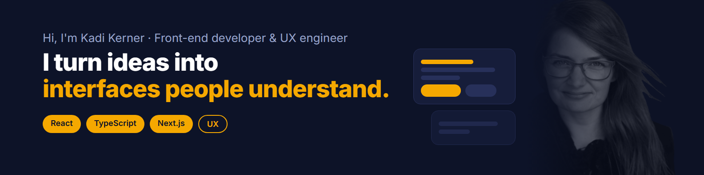
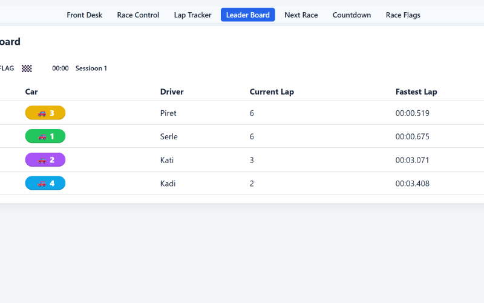
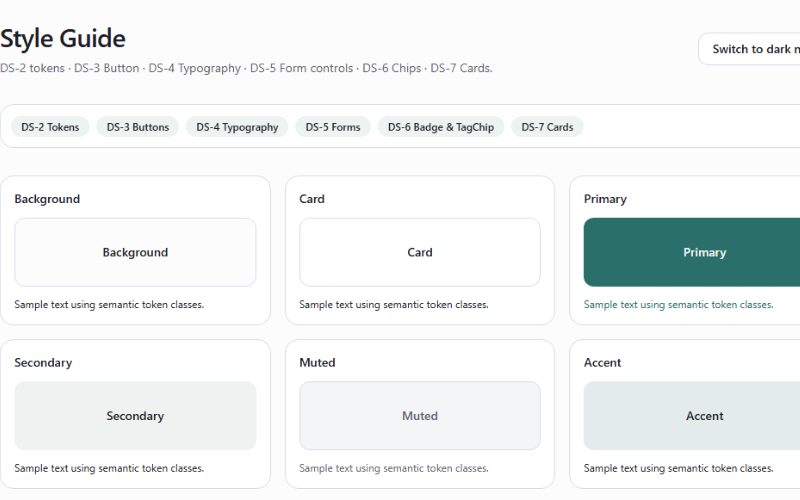
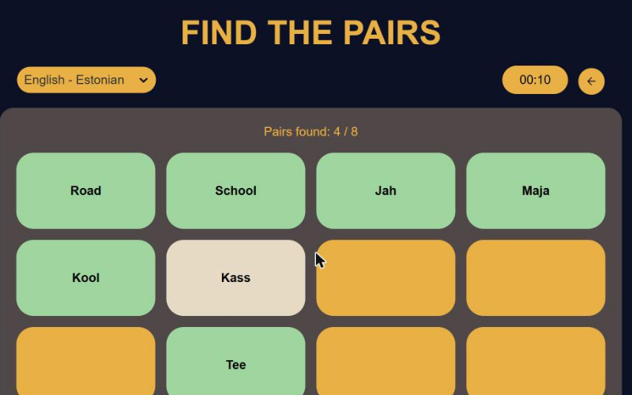

Front-end developer who cares about UX. Based in Tallinn, Estonia.
I build interfaces with React, TypeScript and Next.js, and I like to test ideas with real users before building them.

### Featured projects

<table>
  <tr>
    <td width="33%" valign="top">
      
      <b><a href="https://github.com/punane06/racetrack_motivaatorid">Racetrack</a></b> 
      Real-time race app for several screens. React, TypeScript, Socket.IO. Team lead.
    </td>
    <td width="33%" valign="top">
      
      <b><a href="https://github.com/punane06/t-artbridge-front">ArtBridge</a></b> 
      Design system and frontend. Next.js 16, React 19, Tailwind, Radix UI.
    </td>
    <td width="33%" valign="top">
      
      <b><a href="https://github.com/punane06/language-memory-game">Language memory game</a></b> 
      Find word pairs in two languages. Next.js, TypeScript, Zustand.
    </td>
  </tr>
</table>

**Also:** [El Plato Seguro landing](https://github.com/punane06/d-sales) – Next.js, Tailwind ([live](https://d-sales.vercel.app)) · [CASHY](https://www.cashygame.com/) – financial literacy game for schools, front-end from scratch (code is private) · [movie-api](https://github.com/punane06/-kood_movie-api) – Spring Boot REST API

**Tools:** React · TypeScript · Next.js · Tailwind · Sass · Zustand · Vitest · Playwright · Figma · Storybook · Git

Portfolio: [kadikerner.ee](https://kadikerner.ee)
